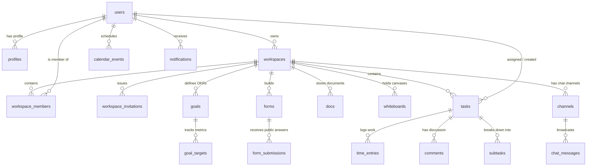

# ONEDESK — TECHNICAL ARCHITECTURE & SYSTEMS ENGINEERING

> **Document Type:** Full-Stack Architecture, System Design & Database Specification  
> **Target Audience:** Principal Engineers, DevOps Architects, Security Auditors  
> **Status:** Verified with Live Codebase & PostgreSQL Schema

---

## ১. সম্পূর্ণ টেকনোলজি স্ট্যাক (Complete Technology Stack)

OneDesk অত্যন্ত আধুনিক, দ্রুতগতির এবং মডার্ন ওয়েব আর্কিটেকচারের ওপর ভিত্তি করে গড়ে উঠেছে:

| লেয়ার (Layer) | টেকনোলজি (Technology) | ভার্সন / বিবরণ | ভূমিকা (Role) |
| :--- | :--- | :--- | :--- |
| **Frontend Framework** | **React** | `19.0.0` | কম্পোনেন্ট-ভিত্তিক আধুনিক রেন্ডারিং ও স্ট্রিমিং ইউআই। |
| **Language** | **TypeScript** | `~5.7.2` | টাইপ-সেফ কোডবেস, জেনেরিক ডাটাবেস ইন্টারফেস ও কম্পাইল-টাইম ইরোর চেকিং। |
| **Build & Dev Tool** | **Vite** | `^6.2.0` | সাব-সেকেন্ড এইচএমআর (HMR) এবং অতি দ্রুত প্রোডাকশন বান্ডলার (৯৬৩ মিলিসেকেন্ডে বিল্ড)। |
| **Styling & Design** | **Vanilla CSS + Modern Tokens** | Custom HSL Design Tokens | ClickUp 3.0 গ্লাস-মরফিজম, স্মুথ গ্রেডিয়েন্ট এবং ডার্ক/লাইট মোড প্যালেট। |
| **Routing Engine** | **React Router DOM** | `^7.2.0` | এসপিএ (SPA) ক্লায়েন্ট-সাইড রাউটিং ও প্রটেক্টেড রুট গার্ডিং। |
| **Backend & Database** | **Supabase (PostgreSQL)** | PostgreSQL 15+ | ক্লাউড ডাটাবেস, বিল্ট-ইন অথেনটিকেশন, স্টোরেজ ও রিয়েল-টাইম ইঞ্জিন। |
| **Auth & Security** | **Supabase Auth + JWT** | GoTrue Engine | ইমেইল/পাসওয়ার্ড, ক্রিপ্টোগ্রাফিক টোকেন ও রো-লেভেল সিকিউরিটি (RLS)। |
| **Realtime Engine** | **Supabase Realtime** | WebSockets (Postgres Changes) | চ্যানেল চ্যাট, অ্যাক্টিভিটি নোটিফিকেশন ও ইনস্ট্যান্ট স্টেট ব্রডকাস্ট। |
| **Icons & Visuals** | **Lucide React + Canvas Confetti** | `lucide-react`, `canvas-confetti` | ভেক্টর আইকনোগ্রাফি এবং ইন্টারেক্টিভ সেলিব্রেশন ফিজিক্স। |
| **Linter & Code Quality** | **Oxlint** | `oxlint` (Rust-based) | অতি দ্রুত স্ট্যাটিক এনালাইসিস (০ এরর)। |

---

## ২. অ্যাপ্লিকেশন স্ট্রাকচার ও রাউটিং আর্কিটেকচার (Application Routing Hierarchy)

OneDesk একটি স্বয়ংসম্পূর্ণ সিঙ্গেল-পেজ অ্যাপ্লিকেশন (SPA) হিসেবে পরিচালিত হয়। এর মূল রাউটিং ফাইল হলো `src/App.tsx`।

```
Public Routes (উন্মুক্ত পেজ)
├── / ............................... HomePage (ClickUp 3.0 ল্যান্ডিং ও শোকেস)
├── /features/docs .................. Docs ফিচার পেজ
├── /features/tasks ................. Tasks ফিচার পেজ
├── /pricing ........................ প্রাইসিং কম্প্যারিজন পেজ
└── /compare ........................ অন্যান্য কমপিটিটরদের সাথে তুলনামূলক পেজ

Authentication Routes (অথেনটিকেশন)
├── /login (বা /signin) ............. ডেডিকেটেড লগইন পেজ
├── /signup (বা /register) .......... ডেডিকেটেড সাইন-আপ পেজ
├── /forgot-password ................ পাসওয়ার্ড রিকভারি পেজ
├── /reset-password ................. পাসওয়ার্ড রিসেট পেজ
├── /verify-email ................... ইমেইল কোড ভেরিফিকেশন পেজ
└── /auth/callback .................. OAuth ও ইমেইল কনফার্মেশন রিডাইরেক্ট রুট

Invitations (ওয়ার্কস্পেস জয়েনিং)
└── /join (বা /invite) .............. ক্রিপ্টোগ্রাফিক টোকেন ভিত্তিক ইনস্ট্যান্ট জয়েন পেজ

Protected Hubs & Workspace (লগইন করা ইউজারদের জন্য সুরক্ষিত)
└── /workspace (এবং অন্যান্য হাব রুট) -> <ProtectedRoute><WorkspacePage /></ProtectedRoute>
    ├── /projects (টাস্ক বোর্ড ও কানবান)
    ├── /sprints (স্প্রিন্ট ভিউ)
    ├── /agents (এআই এজেন্টস)
    ├── /automations (অটোমেশন হাব)
    ├── /calendar & /scheduling (প্ল্যানার ও ক্যালেন্ডার)
    ├── /brain (ক্লিকআপ ব্রেন এআই চ্যাট)
    ├── /dashboards (অ্যানালিটিক্স ড্যাশবোর্ড)
    ├── /whiteboards (হোয়াইটবোর্ড ক্যানভাস)
    ├── /time (টাইমশিট ও আওয়ার লগ)
    ├── /docs (নলেজ বেস ডক্স)
    ├── /forms (ক্লায়েন্ট ফর্ম বিল্ডার)
    ├── /clips (ভিডিও ক্লিপস)
    ├── /goals (স্ট্র্যাটেজিক ওকেআর)
    ├── /apps (ইন্টিগ্রেশন অ্যাপস সেন্টার)
    └── /chat/* (চ্যানেল ও ডিরেক্ট মেসেজ)
```

---

## ৩. ডাটাবেস স্কিমা ও রিলেশনশিপ (Database Entities & Relationships)

OneDesk-এর পোস্টগ্রিস ডাটাবেসে ২৩টি সুসংগঠিত টেবিল রয়েছে। নিচে প্রধান এন্টিটিগুলোর রিলেশনশিপ তুলে ধরা হলো:



### প্রধান টেবিলসমূহের বর্ণনা (Verified PostgreSQL Tables):

1. **`public.profiles`:** ইউজারের মৌলিক পরিচিতি (ID, Name, Email, Role, Workspace Name, Avatar)।
2. **`public.workspaces`:** প্রতিটি ওয়ার্কস্পেসের ওনার ও মেটাডাটা।
3. **`public.workspace_members`:** মাল্টি-ইউজার মেম্বারশিপ ও রোল (`owner`, `admin`, `member`, `guest`)।
4. **`public.workspace_invitations`:** সিকিউর ইনভাইটেশন টোকেন ও এক্সপায়ারি মেটাডাটা।
5. **`public.tasks`:** ইউনিক UUID, টাস্ক কি, টাইটেল, স্ট্যাটাস (`TODO`, `IN PROGRESS`, `REVIEW`, `COMPLETE`), প্রায়োরিটি, ডিউ ডেট, অ্যাসাইনি এবং ওনার আইডি।
6. **`public.time_entries`:** নির্দিষ্ট টাস্কে কাজ করা সময় (সেকেন্ডে), ডেসক্রিপশন এবং বিলযোগ্য স্ট্যাটাস।
7. **`public.chat_messages`:** চ্যানেলের রিয়েল-টাইম বার্তা, প্রেরকের নাম, অ্যাভাটার ও টাইমস্ট্যাম্প।
8. **`public.whiteboards`:** ভেক্টর ক্যানভাসের JSONB ডেটা।
9. **`public.docs`:** রিচ টেক্সট কনটেন্ট ও টাইটেল।
10. **`public.calendar_events`:** ক্যালেন্ডার ইভেন্ট, গুগল মিট ইউআরএল ও সময়সীমা।
11. **`public.notifications`:** অ্যাক্টিভিটি নোটিফিকেশন ও রিড/আনরিড স্ট্যাটাস।
12. **`public.forms` & `public.form_submissions`:** ডায়নামিক ফর্ম স্কিমা এবং ক্লায়েন্ট রেসপন্স।
13. **`public.goals` & `public.goal_targets`:** স্ট্র্যাটেজিক গোল এবং কি-রেজাল্ট মেট্রিক্স।

---

## ৪. ডেটা ফ্লো আর্কিটেকচার (Data Flow Architecture)

OneDesk একটি ইউনিফাইড রিঅ্যাক্টিভ ডেটা ফ্লো অনুসরণ করে:

```
[ ইউজার অ্যাকশন (User Action) ]
              │ (যেমন: কানবান বোর্ডে টাস্ক স্ট্যাটাস পরিবর্তন)
              ▼
[ ফ্রন্টএন্ড কম্পোনেন্ট (React Component: KanbanBoard.tsx) ]
              │ (অপটিমিস্টিক লোকাল স্টেট আপডেট)
              ▼
[ অ্যাপ্লিকেশন সার্ভিস (supabaseService.ts / workspaceService.ts) ]
              │ (UUID ভ্যালিডেশন এবং টাইপ স্যানিটাইজেশন)
              ▼
[ সুপাবেস ক্লায়েন্ট (Supabase JS SDK with Anon Key) ]
              │ (HTTPS REST API / WebSocket RPC)
              ▼
[ PostgreSQL Database with Active RLS (Row Level Security) ]
              │ (অনুমতি যাচাই: auth.uid() == user_id ?)
              ▼
       ┌──────┴──────┐
       │             │
 (অনুমোদিত - 200 OK)  (অননুমোদিত - 42501 Rejected)
       │             │
       ▼             ▼
[ ডাটাবেসে পারসিস্ট ] [ এরর হ্যান্ডলিং ও ইউজার অ্যালার্ট ]
       │
       ▼
[ সুপাবেস রিয়েল-টাইম ব্রডকাস্ট (WebSocket) ]
       │
       ▼
[ সকল অনলাইন ইউজারের ইউআই পেজ রিফ্রেশ ছাড়াই স্বয়ংক্রিয় আপডেট ]
```

---

## ৫. ডিপ্লয়মেন্ট ও ক্লাউড কনফিগারেশন (Deployment Configuration)

### জিরো-কস্ট ($0 Budget) হোস্ট কনফিগারেশন:
- **Vercel / Netlify SPA রিরাইট রুল:**  
  সিঙ্গেল-পেজ অ্যাপ্লিকেশনের সরাসরি সাব-রুটে (যেমন: `/workspace`, `/join?token=...`) রিফ্রেশ দিলে যেন 404 এরর না আসে, সেজন্য রুট ডিরেক্টরিতে `vercel.json` কনফিগার করা রয়েছে:
  ```json
  {
    "rewrites": [
      { "source": "/(.*)", "destination": "/index.html" }
    ]
  }
  ```
- **এনভায়রনমেন্ট ভেরিয়েবলস:**
  - `VITE_SUPABASE_URL`: আপনার সুপাবেস প্রজেক্টের এপিআই বেস ইউআরএল।
  - `VITE_SUPABASE_ANON_KEY`: সুপাবেস পাবলিক অ্যানোনিমাস কি (যা ফ্রন্টএন্ডে নিরাপদ কারণ ডেটা সুরক্ষার দায়িত্বে থাকে পোস্টগ্রিসের শক্তিশালী RLS পলিসি)।

---

## ৬. সিকিউরিটি অডিট ও পারমিশন কন্ট্রোল (Security & Isolation Audit)

Phase 4 সিকিউরিটি অডিটে নিশ্চিত করা হয়েছে:
1. **কোনো সিক্রেট কি লিক হয়নি:** `service_role` কি কোনো ফ্রন্টএন্ড বা বান্ডল ফাইলে উন্মুক্ত নয়।
2. **প্রিভিলেজ এসকেলেশন প্রতিরোধ:** সাধারণ মেম্বাররা নিজেদের রোল পরিবর্তন করে ওনার বা অ্যাডমিন বানাতে পারে না (পোস্টগ্রিস RLS এরর ৪২৫০১ দিয়ে ব্লক করে)।
3. **ক্রস-ইউজার টেম্পারিং প্রতিরোধ:** অন্য ইউজারের প্রাইভেট টাস্কে অননুমোদিত কেউ আপডেট বা ডিলিট করতে পারে না।
4. **পাবলিক ফর্ম আইসোলেশন:** পাবলিক ইউজাররা ফর্ম সাবমিট করতে পারলেও অন্যদের সাবমিট করা রেসপন্স ডেটা পড়তে পারে না।
